# Vision Action Platform

영상 속 사람의 **동작 6가지**를 AI로 판정하는 웹 서비스입니다.
영상을 업로드하거나 휴대폰 IP Webcam으로 촬영하면, 사람마다 동작과 Confidence를 보여 주고 결과를 DB에 저장합니다.

> 교과 10 (자세 추정·동작 인식) 평가 과제 — Django · DRF · Celery · Redis · PostgreSQL · FastAPI · Docker Compose

| 코드 | 동작 | 코드 | 동작 |
|---|---|---|---|
| A001 | 허리 굽혔다 펴기 | A004 | 마시고 원위치 |
| A002 | 다리 들었다 내리기 | A005 | 앉았다 일어나기 |
| A003 | 걷다 방향 전환 | A006 | 손 흔들기 |

---

## 1. 시스템 구조

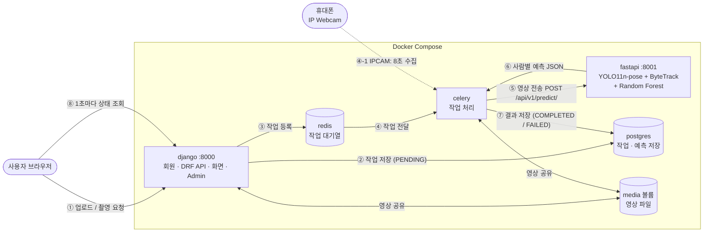

| 서비스 | 역할 | 핵심 파일 |
|---|---|---|
| **django** | 회원가입·로그인, DRF API, 분석 화면, 관리자 대시보드, Admin | `backend/analyses/views.py`, `page_views.py` |
| **celery** | 작업을 꺼내 영상 확보 → FastAPI 호출 → 결과 저장 | `backend/analyses/tasks.py` |
| **redis** | Django와 Celery 사이의 작업 대기열 | – |
| **postgres** | 작업(`AnalysisJob`)과 사람별 예측(`PersonPrediction`) 영구 저장 | `backend/analyses/models.py` |
| **fastapi** | Pose 추정 + Track별 특징 추출 + RF 분류 | `ai_service/routers/predictions.py` |

**AI 서버를 분리한 이유**
- 무거운 모델(torch, YOLO)을 웹 서버와 분리 → Django는 가볍게 유지하고 AI 서버만 따로 교체·확장할 수 있습니다.
- 추론이 수 초 걸리므로 **Celery 비동기 처리**로 요청은 즉시 응답(PENDING)하고, 화면은 상태를 조회합니다.

---

## 2. AI 추론 방식 (clip 방식)

```
영상 ─► YOLO11n-pose + ByteTrack ─► 사람(Track)별 Frame마다 38차원 특징
     ─► Track의 유효 Frame 전체를 30 Step으로 Resample (30 × 38 = 1140)
     ─► Random Forest predict_proba ─► 6개 동작 확률
```

- 6일차 학습과 **같은 방식(clip)** 으로 추론합니다. 실험 결과 S03 영상 6개 중 clip 방식 6/6, 5초 window 방식 2/6 정답.
- **판단 불확실**: 1·2순위 확률 차이가 0.05 미만이면 `uncertain=true`로 표시합니다.
- **오검출 제외**: Frame 10개 미만, 평균 관절 신뢰도 0.35 미만 Track은 예측하지 않고 `skipped_tracks`로 따로 보고합니다.
- 응답 코드: 정상 200 / 사람 없음 200 + 빈 목록 / 확장자·길이 오류 400 / 손상 영상 422 / 모델 미준비 503

---

## 3. 데이터 모델 (ERD)

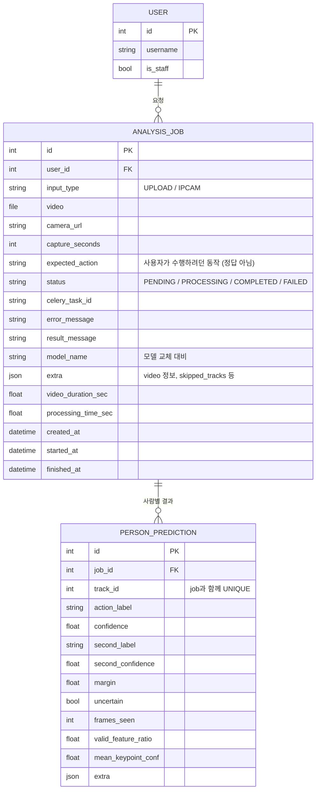

**작업 상태 규칙**

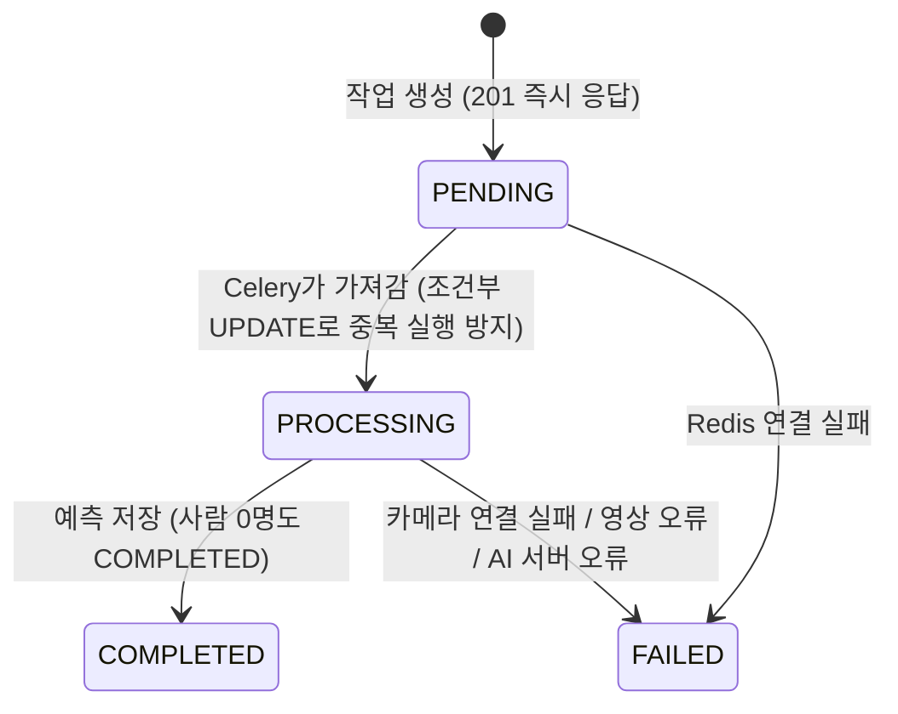

---

## 4. 버튼 클릭 → 결과까지 (파일별 흐름)

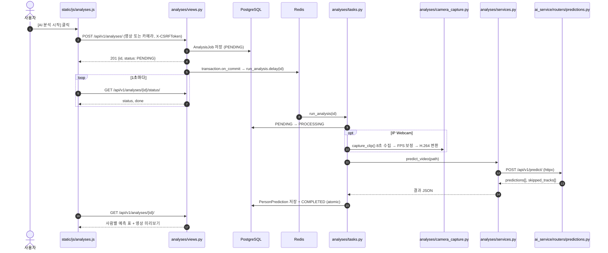

---

## 5. 실행 방법

### 5-1. 모델 파일 준비 (Git 제외)
용량 문제로 가중치 파일은 저장소에 없습니다. 교과 10 6일차 산출물에서 아래 2개를 `ai_service/models/` 에 복사합니다.

| 파일 | 내용 |
|---|---|
| `rf_action_baseline.joblib` | 6일차 Random Forest (입력 1140 = 30 Step × 38) |
| `yolo11n-pose.pt` | Ultralytics YOLO11n Pose 가중치 |

`rf_feature_columns.json`, `rf_training_info.json` 은 저장소에 포함되어 있으며, FastAPI 가 시작할 때 모델과 규격이 맞는지 5가지를 검사합니다 (`/health` 의 `checks`).

### 5-2. Docker Compose (권장)

```bash
cp .env.example .env        # ALLOWED_CAMERA_URLS 를 휴대폰 IP Webcam 주소로 수정
docker compose up -d --build
docker compose exec django python manage.py createsuperuser
```

| 주소 | 내용 |
|---|---|
| http://localhost:8000 | 로그인 → AI 분석 화면 |
| http://localhost:8000/dashboard/ | 관리자 대시보드 (staff 전용) |
| http://localhost:8000/admin/ | Django Admin |
| http://localhost:8000/api/v1/analyses/ | DRF API |
| http://localhost:8001/docs | FastAPI 문서 (개발 확인용) |

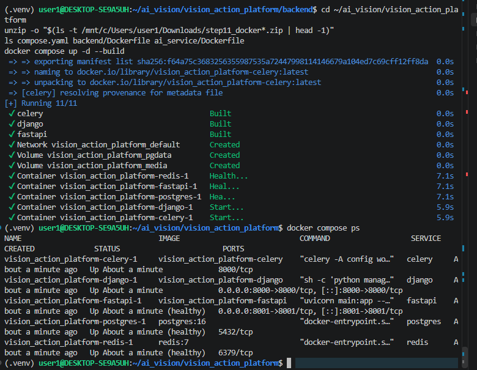

> 컨테이너 사이 통신은 `localhost`가 아니라 서비스 이름(`postgres`, `redis`, `fastapi`)을 씁니다 → `compose.yaml` 의 `x-backend-env`.
> 데이터는 `pgdata`, `media` 볼륨에 있으므로 컨테이너를 지워도 유지됩니다. **`docker compose down -v` 는 데이터까지 지우니 주의.**

### 5-3. 로컬 실행 (개발용, 터미널 4개)

```bash
# 1) FastAPI
cd ai_service && python -m uvicorn main:app --host 0.0.0.0 --port 8001
# 2) Django
cd backend && python manage.py migrate && python manage.py runserver 0.0.0.0:8000
# 3) Celery
cd backend && celery -A config worker -l info
# (PostgreSQL, Redis 는 로컬 서비스로 실행)
```

### 5-4. 테스트

```bash
docker compose exec django python manage.py test analyses accounts
# Ran 49 tests ... OK  (팀 자세 판정 연결 테스트 11개 포함)
```

---

## 6. API

| Method | URL | 설명 |
|---|---|---|
| POST | `/api/v1/analyses/` | 작업 생성 (`input_type`=UPLOAD + `video` / IPCAM + `camera_url`, `capture_seconds` 3~15) |
| GET | `/api/v1/analyses/` | 내 작업 목록 (staff는 전체, 20개씩 페이지) |
| GET | `/api/v1/analyses/{id}/` | 작업 상세 + 사람별 예측 |
| GET | `/api/v1/analyses/{id}/status/` | 상태만 가볍게 조회 (화면 Polling 용) |
| PATCH | `/api/v1/analyses/{id}/` | 제목·메모 수정 |
| DELETE | `/api/v1/analyses/{id}/` | 작업 + 영상 파일 삭제 |
| POST | `fastapi:8001/api/v1/predict/` | (내부) 영상 → 사람별 예측 |
| GET | `fastapi:8001/health` | 모델 로드·규격 검사 결과 |

- 다른 사용자의 작업은 `get_queryset` 에서 걸러져 **404** 로 응답합니다.
- 카메라 주소는 `.env` 의 `ALLOWED_CAMERA_URLS` 에 있는 것만 허용합니다 (서버가 임의 URL을 호출하지 않도록).

---

## 7. 평가 항목 검증

| No | 항목 | 결과 |
|---|---|---|
| T01 | 서비스 상태 확인 | ✅ FastAPI `/health` 모델 규격 검사 5개 통과, Compose 5개 서비스 healthy |
| T02 | 영상 업로드 분석 | ✅ A006 손 흔들기 33.3% (정답) |
| T03 | IP Webcam 분석 | ✅ 8초 수집 → A006 손 흔들기 (정답), 판단 불확실 표시 |
| T04 | 여러 사람 동시 분석 | ✅ SBU hugging 영상 2명 Track별 예측, 오검출 Track 제외 |
| T05 | 비동기 처리 | ✅ 요청 즉시 PENDING 응답 → Celery 처리 → COMPLETED |
| T06 | 이력 저장 | ✅ 새로고침·재로그인 후에도 유지 |
| T07 | 사용자 분리 | ✅ B가 A의 작업 조회 시 404 |
| T08 | 관리자 대시보드 | ✅ PostgreSQL 실데이터 ORM 집계 (staff 전용, 일반 사용자 403) |
| T09 | 실패 처리 | ✅ AI 서버 오류·허용 안 된 카메라·손상 영상 → FAILED + 사유 / 사람 없음 → COMPLETED + 0명 |
| T10 | Docker 재시작 후 유지 | ✅ `docker compose down` → `up` 후 이력·로그인 유지 |

### 증빙 화면

**T02 영상 업로드 분석** (Docker #13)

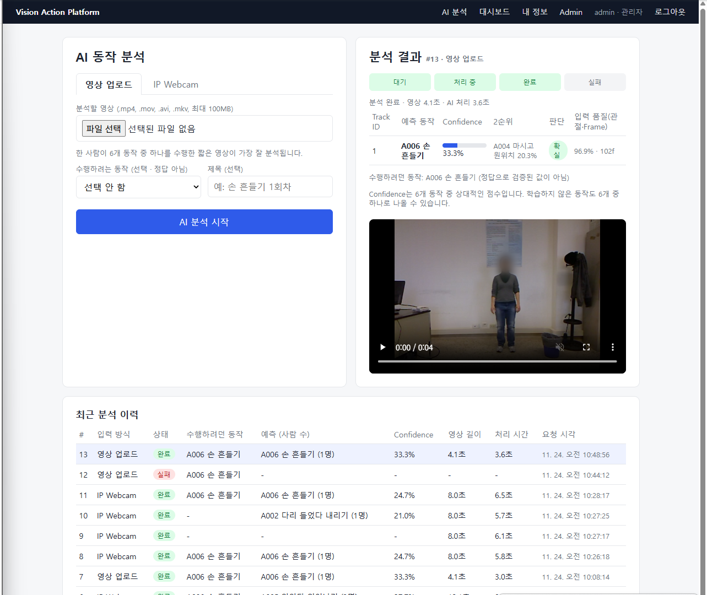

**T03 IP Webcam 분석** — 1·2순위 차이 3% → "판단 불확실" 표시, H.264 변환 후 미리보기 재생

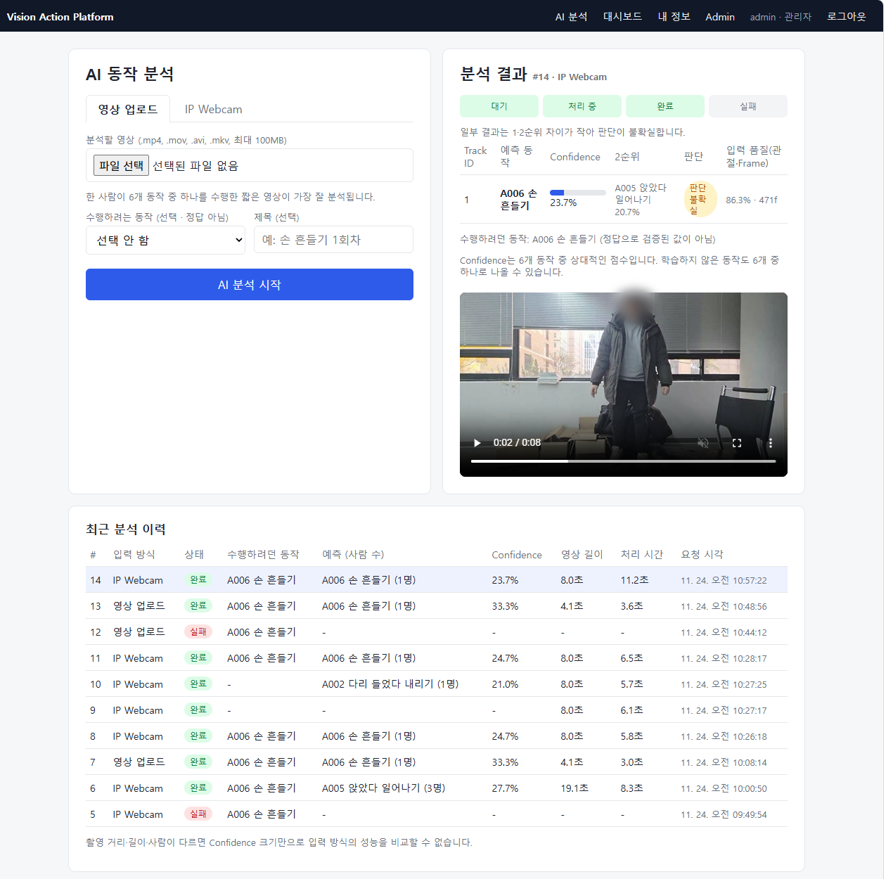

**T08 관리자 대시보드** — 동작별 예측, 작업 상태, 입력 방식 집계

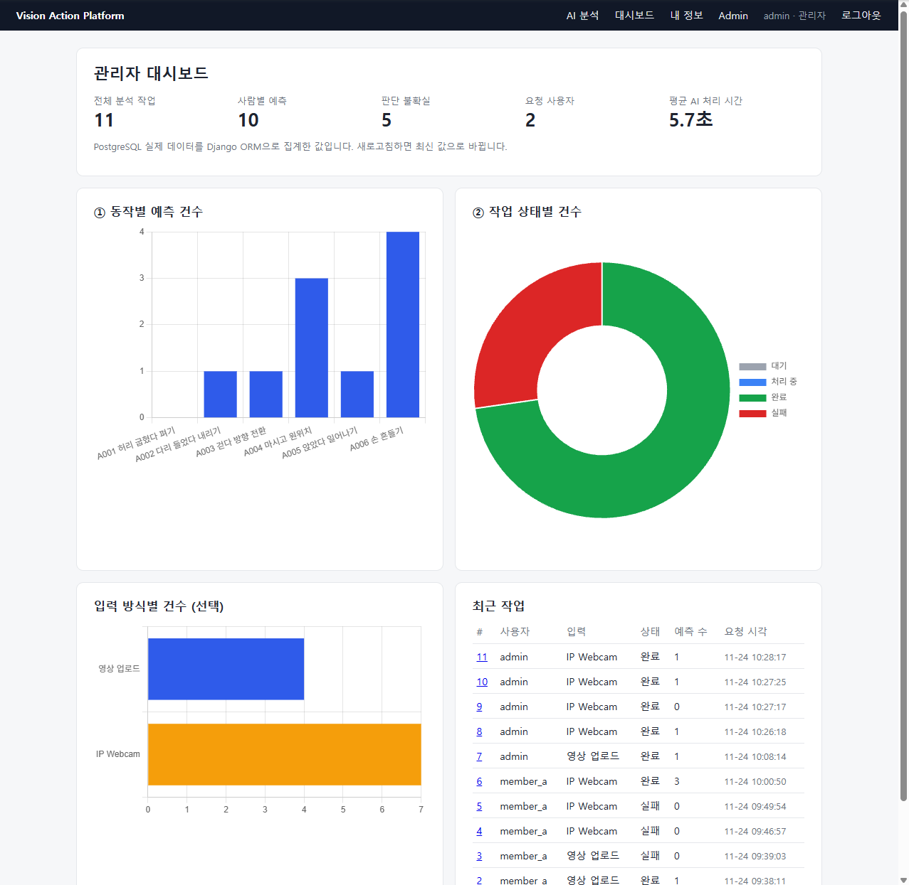

**T09 실패 처리** — AI 서버 500 응답 → 작업 FAILED + 사유 저장

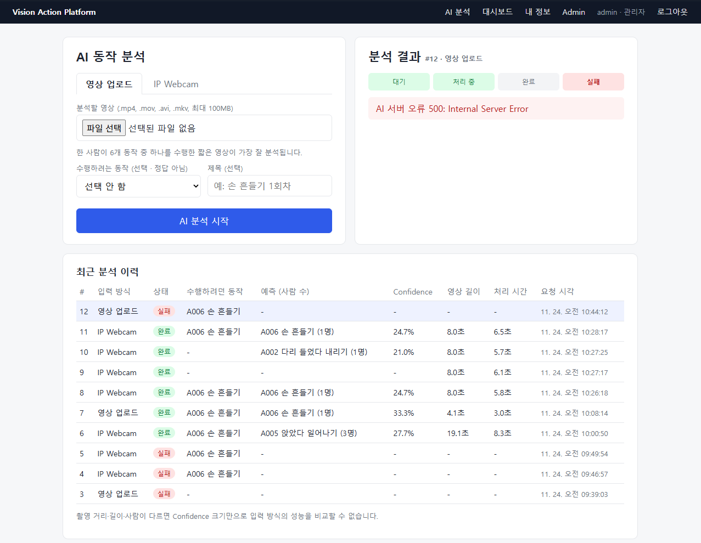

**T04 / T09 FastAPI 직접 호출** — 짧은 오검출 Track 제외(`skipped_tracks`), 손상 영상 422

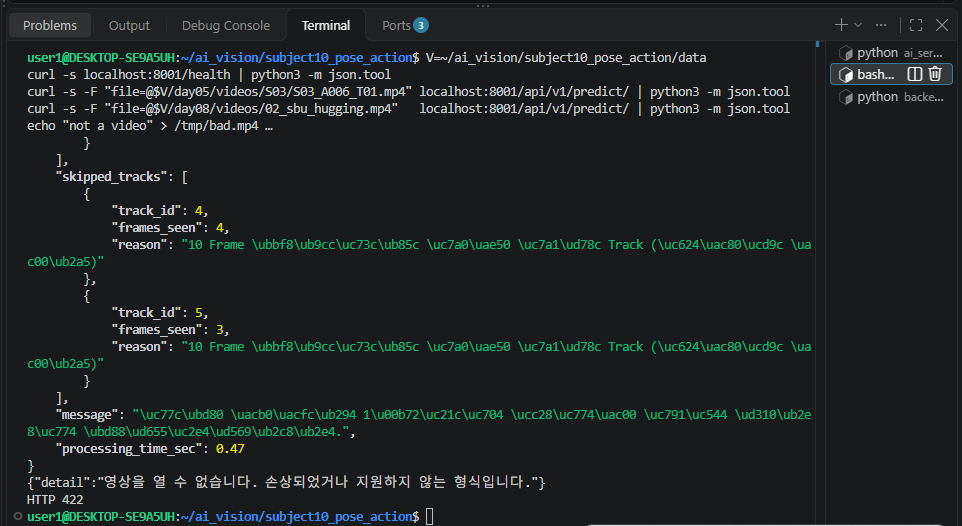

**T05 Celery 처리 로그** — 실패(#12, 500)와 성공(#13, 200 → COMPLETED)

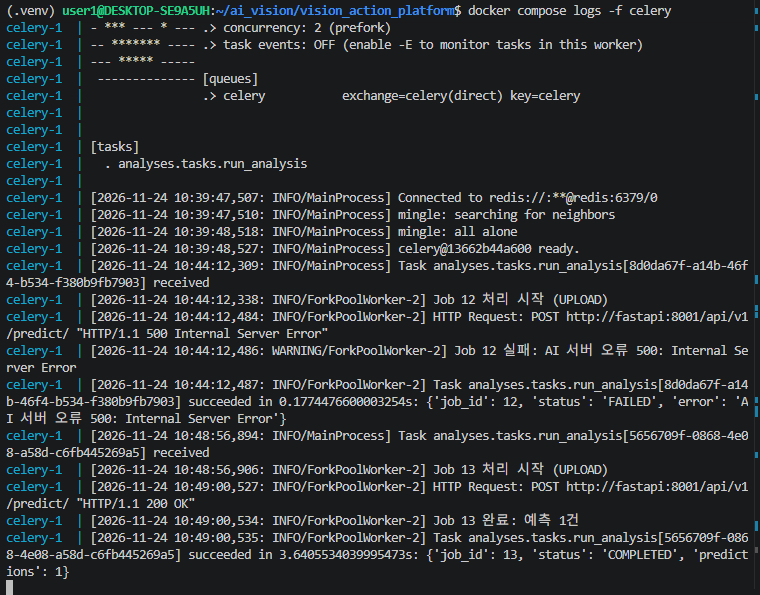

**T10 컨테이너 삭제 후 재생성** — `down`(전부 Removed) → `ps -a`(빈 목록) → `up`

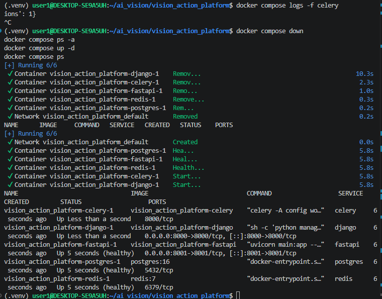

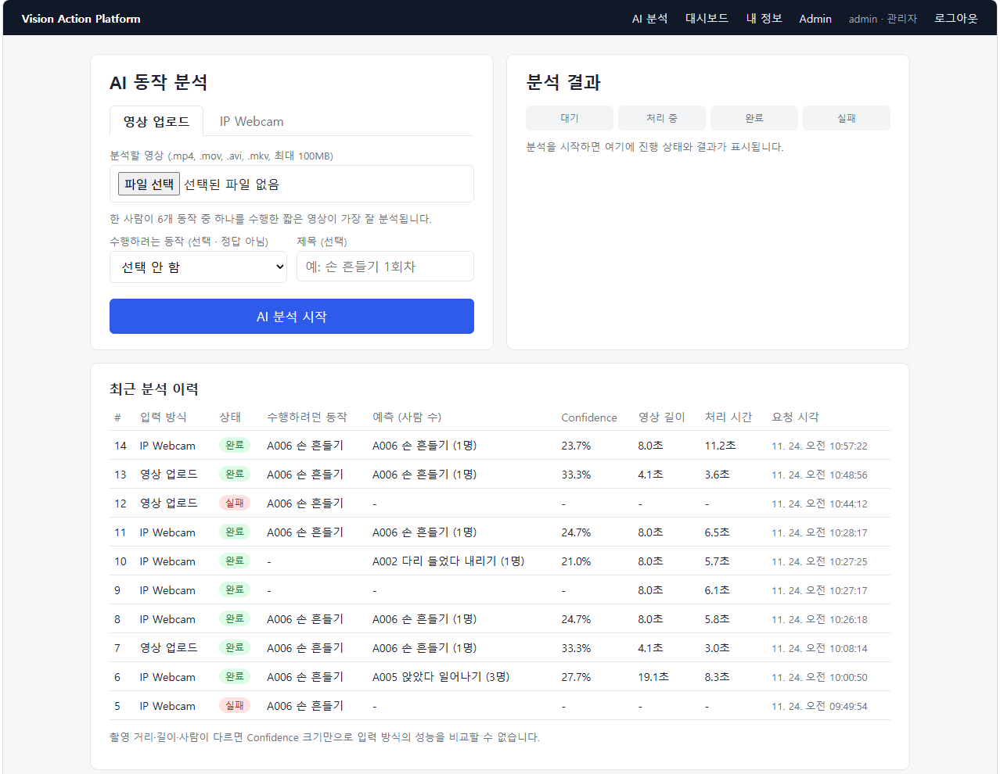

**로컬(GPU) → Docker(CPU) 이전 검증** — 같은 영상

| | 로컬 #7 | Docker #13 |
|---|---|---|
| 예측 | A006 손 흔들기 | A006 손 흔들기 |
| Confidence | 33.3% | 33.3% |
| AI 처리 시간 | 3.0초 | 3.6초 |

**자동 테스트 49개** (팀 자세 판정 연결 11개 포함) — 정상 흐름뿐 아니라 실패 상황(Redis 끊김, AI 서버 다운, 손상 영상, 카메라 연결 실패, 중복 실행, 다른 사용자 접근)도 가짜(mock)로 만들어 검증합니다.

---

## 8. 오류 해결 사례

| # | 증상 | 원인 | 해결 |
|---|---|---|---|
| 1 | 허용한 카메라 주소인데 "허용되지 않은 카메라" | 셸에 남아 있던 예전 환경 변수를 `load_dotenv` 가 덮어쓰지 않음 | 셸 변수 `unset` 후 재시작 (`.env` 만 기준으로) |
| 2 | 8초 수집했는데 19초 영상, 3명 검출, 오답 | MJPEG 스트림이 FPS를 0으로 알려 기본 15fps로 저장 (실제 약 59fps) + 관절 신뢰도 0.2 오검출 Track | 실제 측정 FPS로 다시 기록, 관절 신뢰도 0.35 미만 Track 제외 → 8.0초·1명·정답 |
| 3 | 테스트가 멈춤 | 가짜 카메라가 Frame을 끝없이 주는데 FPS 보정 함수가 `while True` 로 읽음 | 저장한 Frame 수만큼만 읽도록 제한 + 보정 함수 단독 테스트 추가 |
| 4 | Docker에서만 AI 서버 500 (`torchvision::nms does not exist`) | CPU용 torch 와 PyPI 의 다른 빌드 torchvision 이 섞임 | torch·torchvision 을 같은 CPU 저장소에서 함께 설치 (`2.15.0+cpu` / `0.29.2+cpu`) |
| 5 | IP Webcam 영상만 브라우저에서 재생 안 됨 (0:00) | pip OpenCV 에 H.264 인코더가 없어 mp4v 로 저장 | 수집 후 ffmpeg 로 H.264 변환 + 기존 영상 일괄 변환 명령 `convert_captures` |

---

## 9. 팀 모델 연결: 맨몸운동 자세 판정

강사님 안내대로 수업 모델로 서비스를 먼저 완성한 뒤, **팀 프로젝트(G5_skeleton/subject10_team_pilot) 판정 엔진**을 붙였습니다.
Django·Celery·DB·화면 흐름은 그대로이고, **AI 서버만 하나 추가**했습니다.

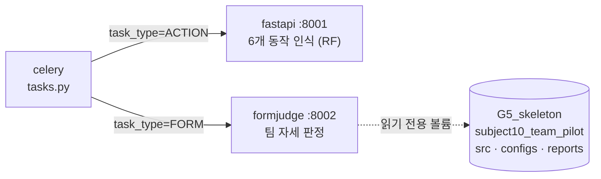

| 구분 | 동작 인식 (수업 모델) | 자세 판정 (팀 모델) |
|---|---|---|
| 질문 | 어떤 동작인가? (6개 중 하나) | 그 동작을 바르게 했나? (회차마다) |
| AI 서버 | `ai_service` (YOLO Pose + ByteTrack + RF) | `form_service` (YOLO Pose + 팀 `OnlineJudge`) |
| 결과 저장 | `PersonPrediction` (사람별) | `RepJudgment` (회차별 OK / NG / CHECK + 교정 메시지) |
| 대상 | A001~A006 | 버피 A001 · 런지 A004 · 스쿼트 점프 A008 |

- **팀 코드는 복사하지 않습니다.** `formjudge` 컨테이너가 팀 프로젝트를 `/team`(읽기 전용)으로 연결해, 팀 웹·실시간·터미널 판정과 **같은 엔진**(`src/realtime_judge.py`)과 **같은 판정 기준**(`reports/team_projects/team05/standards`)을 씁니다.
- `AnalysisJob.task_type`(ACTION / FORM), `exercise`, `camera_view` 를 추가했고(마이그레이션 0003), 모델 이름은 `model_name = team05_form_rules` 로 남습니다.
- 팀 기준 파일이 없는 각도는 CHECK 로만 나오고, `GET :8002/health` 의 `artifacts` 에서 동작·각도별 기준 파일 유무를 확인할 수 있습니다.
- `formjudge` 가 준비되지 않아도 동작 인식은 그대로 동작합니다 (`depends_on: service_started`).

**실행**

```bash
# 팀 프로젝트가 ~/ai_vision/G5_skeleton/subject10_team_pilot 에 있고 판정 기준(reports)이 만들어져 있어야 함
docker compose up -d --build formjudge celery django
curl -s localhost:8002/health | python3 -m json.tool
docker compose exec django python manage.py migrate
```

다른 위치라면 `.env` 에 `TEAM_PROJECT_DIR=/절대/경로/subject10_team_pilot` 를 넣습니다.

## 10. 한계와 다음 단계

- **Confidence가 낮음 (20~35%)**: 6개 동작 중 상대 점수이며, 학습 데이터가 적은 RF 기준 모델의 한계입니다. 학습하지 않은 동작도 6개 중 하나로 나옵니다.
- **팀 모델 연결 (9절)**: 수업 모델(6개 동작 인식)은 그대로 두고, 팀 자세 판정 엔진을 두 번째 AI 서버로 붙였습니다. 팀 판정 기준을 `rules-v1`로 동결하고 test_ext 평가를 마치면 최종 성능을 추가합니다.
- CPU 컨테이너는 Frame이 많은 영상(471 Frame)에서 처리 시간이 늘어납니다 → GPU 컨테이너(NVIDIA Container Toolkit) 적용 여지.

---

## 폴더 구조

```
vision_action_platform/
├── compose.yaml
├── .env.example
├── form_service/            # 팀 자세 판정 AI 서버 (G5_skeleton 엔진 연결)
├── ai_service/              # FastAPI 추론 서버
│   ├── main.py              # /health, lifespan 에서 모델 1회 로드
│   ├── routers/predictions.py
│   ├── services/            # model_loader · pose_pipeline · action_inference
│   ├── src/                 # 교과 10 특징 추출 코드 (학습과 동일)
│   ├── configs/
│   └── models/              # joblib · pt (Git 제외)
└── backend/                 # Django
    ├── config/              # settings · urls · celery
    ├── accounts/            # 회원가입 · 내 정보
    ├── analyses/            # 모델 · API · Celery 작업 · 카메라 수집 · 화면
    ├── templates/
    └── static/
```
